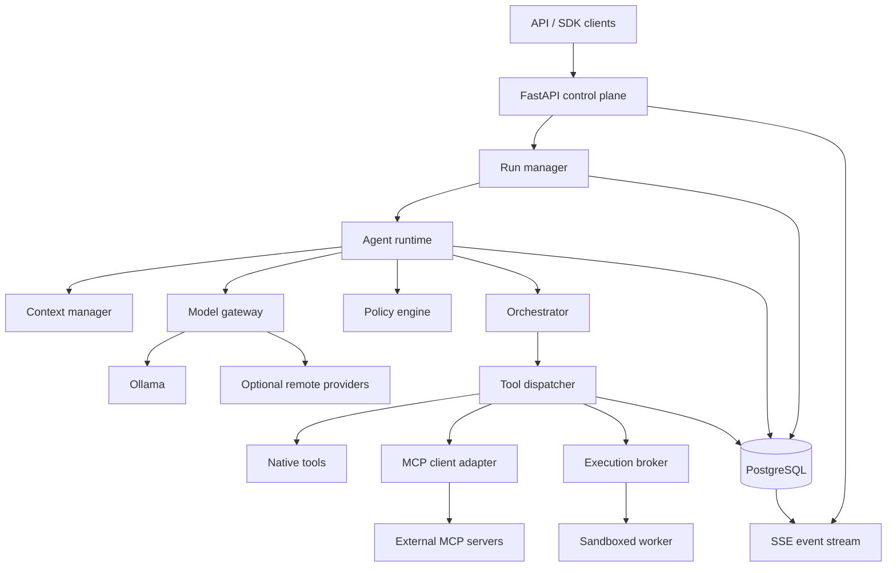
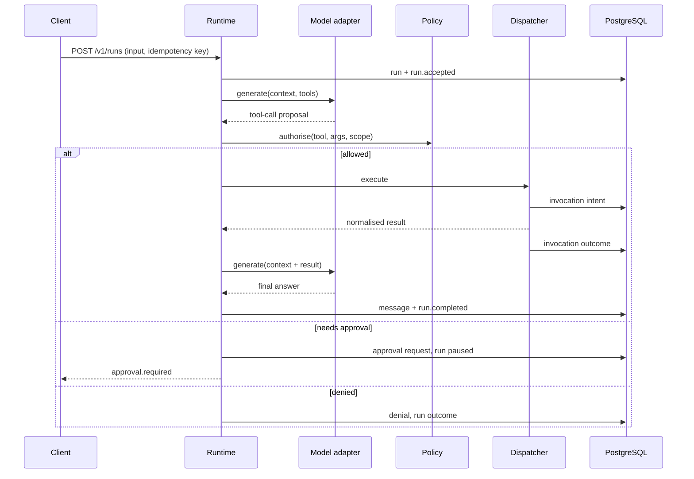

# Architecture

A Python modular monolith with explicit adapter boundaries. The boxes below are logical components, not services. Everything runs in one process until a concrete need (isolation, scaling, independent deployment) justifies splitting something out.

## Principles

1. The model proposes; deterministic code validates, authorises, schedules, and executes.
2. The runtime owns the agent loop. Clients submit commands and render events; they hold no agent or authorisation logic.
3. The orchestrator is our own code, framework-independent, and in-process to start.
4. Model providers and tool transports sit behind internal interfaces (ports and adapters).
5. Model output, MCP servers, web content, documents, and tool results are untrusted input.
6. Model-generated code and shell commands never run in the API process.
7. Application state (PostgreSQL) and telemetry (traces, logs, metrics) are separate records with different retention rules.
8. Every external side effect has defined retry and idempotency behaviour.
9. New services and infrastructure need evidence, not anticipation.

## Components

**CLI.** The first client. In milestone 1 it calls the runtime directly; from milestone 2 it is an API client like any other.

**API / control plane.** Request validation, run creation and queries, approval and cancellation commands, event streaming over SSE, quotas. FastAPI. No reasoning logic, no user code. See [API_SPEC.md](API_SPEC.md).

**Run manager.** Creates runs, binds each to an agent configuration version, enforces lifecycle transitions, and coordinates persistence. A thread (conversation) can contain many runs.

**Agent runtime.** The bounded model ↔ tool loop. See [RUNTIME_SPEC.md](RUNTIME_SPEC.md).

**Context manager.** Builds each model request from stored history under a token budget: selects, summarises, retrieves, or drops messages. It is not the store of record. Compaction keeps provenance and never silently drops hard constraints.

**Model gateway.** Maps a logical profile to a provider adapter. Owns capability checks, timeouts, safe retries, usage accounting, and fallback. See [MODEL_SPEC.md](MODEL_SPEC.md).

**Orchestrator.** Validates plans (as data), schedules ready nodes under concurrency and budget limits, and handles failure and cancellation. Executes registered operations only. See [RUNTIME_SPEC.md](RUNTIME_SPEC.md#orchestration).

**Tool registry and dispatcher.** The registry holds trusted definitions; the dispatcher validates arguments, checks policy, executes with timeouts, normalises output, and records the invocation. Native and MCP tools share this path. See [TOOL_SPEC.md](TOOL_SPEC.md).

**Policy engine.** Decides allow, deny, or require-approval from identity, granted scopes, tool risk, and resource limits. A model's claim that something is safe counts for nothing.

**Execution broker.** A separate process boundary for filesystem, shell, browser, and code. Accepts structured, policy-checked requests and runs them in restricted workers. The sandbox backend is open. See [SECURITY_SPEC.md](SECURITY_SPEC.md).

**Persistence.** PostgreSQL holds agent versions, threads, messages, runs, steps, tool invocations, approvals, and an append-only run event history. That history supports audit and replay to clients; it does not make the system event-sourced. See [DATA_MODEL.md](DATA_MODEL.md).

**Observability.** See [below](#observability).



## Trust boundaries

| Actor | Role | Trust |
|---|---|---|
| API client | Creates runs, streams events, approves, cancels | Authenticated; request content untrusted |
| Agent runtime | Builds context, calls models, interprets results | Trusted code |
| Model | Produces text, structured output, tool-call proposals | Untrusted; never an authority |
| Native tool | In-process application function | Trusted only for its declared capability |
| MCP server | External tool provider | Separate trust domain; metadata and output untrusted |
| Execution worker | Runs powerful operations | Separate boundary, least privilege |
| PostgreSQL | Application state | Trusted, access-controlled |
| Ollama | Local inference | Local service; keep it on loopback |

## One tool-assisted run



## Dependency rules

- `domain` imports only the standard library and Pydantic ([ADR 0016](adr/0016-pydantic-domain-types.md)): no web framework, ORM, provider SDK, MCP SDK, or Temporal code.
- `application` defines use cases and ports; infrastructure implements the ports.
- `runtime` reaches models through model ports and tools through the dispatcher port.
- `orchestration` is deterministic for a given plan, state, and input. Plan validation never calls a model.
- Infrastructure (API, database, providers, MCP, telemetry, execution) lives in adapters.

## Source layout

The target shape. Create directories as their phase starts, not all at once.

```text
pyproject.toml, uv.lock, .python-version   # M1.1
src/agent_platform/
    domain/  application/  runtime/  orchestration/  models/
    tools/  security/  persistence/  api/  observability/
tests/{unit,integration,contract,evaluation,security}/
evals/        # versioned evaluation cases and harness
infra/compose/
scripts/
docs/
```

Directories are modules in one package, not separate services or distributions.

## Deployment

Portable by design ([ADR 0012](adr/0012-portable-deployment.md)): containers, configuration from the environment, no state in app processes, health and readiness endpoints, logs to stdout. The same stack runs on the laptop or any Linux host; only configuration differs.

- **Milestone 1:** the CLI calls the runtime in-process. Ollama, or an optional hosted API, is reached at a configured endpoint.
- **Milestone 2 onward:** one Python service (API and runtime), PostgreSQL, and an optional telemetry profile, started with Docker Compose. The CLI becomes an API client.
- **Later, if justified:** separate API and worker processes, restricted execution workers, Temporal, TypeScript MCP servers.

## Observability

Three separate data products:

- **Run event history** in PostgreSQL: the authoritative record of what a run did. Used for inspection, audit, and client replay.
- **Traces** via OpenTelemetry. One span per causal operation: `api.request` → `agent.run` → `context.build`, `model.generate`, `policy.evaluate`, `tool.execute`, `approval.wait`. GenAI semantic conventions are still evolving, so pin the version you adopt.
- **Structured logs and metrics**, carrying run, step, and correlation IDs. Metrics cover run counts and durations, model and tool latency and errors, in-flight work, approval waits, and budget exhaustion.

Rules:

- Metric labels stay bounded: no run IDs, prompts, paths, user IDs, or tool names taken from untrusted sources.
- Record metadata and digests by default, not raw prompts, tool payloads, file contents, headers, or secrets. Debug payload capture is opt-in, access-controlled, and time-limited.
- Start with structured logs and the OTel SDK. A Collector with Grafana, Tempo, and Prometheus is an optional Compose profile once traces are worth looking at. Unit tests never need the telemetry stack.

## Deferred choices

Python minor version · PostgreSQL major version and driver · ASGI and worker topology · sandbox backend · router policy and fallback · Temporal adoption · artifact storage backend. Each is tracked in an ADR or research note.
