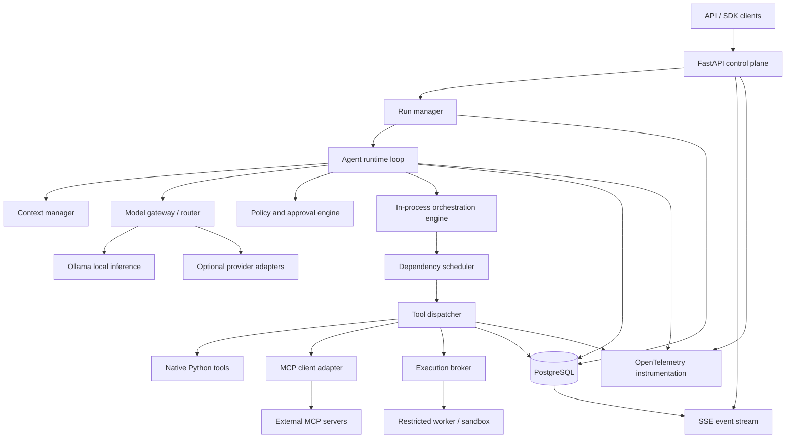
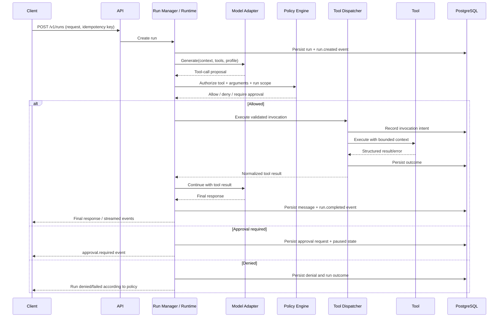

# System Architecture

**Architecture style:** Python modular monolith initially, with explicit adapter boundaries and optional separate worker processes. This is a logical architecture, not a requirement to deploy every box as an independent service.

## 1. Design principles

1. The model proposes; deterministic application code validates, authorizes, schedules, and executes.
2. The runtime owns the agent loop; clients only submit commands and render state/events.
3. The orchestration engine is framework-independent and starts in-process.
4. Model providers and tool transports are adapters behind internal contracts.
5. The model server, MCP servers, web pages, documents, and tool results are untrusted inputs.
6. The API/control plane must not execute model-generated code or arbitrary shell commands in its own privilege context.
7. Persisted application state and telemetry traces are related but distinct records.
8. Every external side effect needs explicit retry/idempotency semantics.
9. Introduce services and infrastructure only when evidence justifies them.

## 2. Logical components

### API and control plane

Responsibilities: authentication boundary, request validation, run creation/queries, approval/cancellation commands, streaming event delivery, and application-level quotas. It should not own model reasoning logic or run arbitrary user code.

Initial implementation: FastAPI application in the Python package. The first interface is a versioned HTTP API plus server-sent events (SSE). An SDK can wrap it. No polished UI is required initially.

### Run manager

Creates and transitions runs, binds them to agent configuration versions, enforces lifecycle invariants, and coordinates persistence. A thread/conversation is not the same thing as a run: a thread can contain multiple runs.

### Agent runtime

Implements the bounded interaction loop:

1. Load run and versioned agent configuration.
2. Construct model context from system/developer instructions, conversation history, relevant tool definitions, and selected retrieved state.
3. Select model profile/provider using a policy.
4. Invoke the model adapter.
5. Parse and normalize the response.
6. For each requested action, validate schema and policy before dispatch.
7. Collect and persist results/events.
8. Continue, pause, delegate, or complete based on normalized outcome and run budget.
9. Stop on final response, denial, cancellation, or budget exhaustion.

### Context manager

Builds the request context; it is not the canonical store of the conversation. Persist history separately, then select, summarize, retrieve, or omit messages for each model invocation under an explicit token/context budget. Context compaction must preserve provenance and not silently discard critical constraints.

### Model gateway/router

Maps a logical role/task to a model profile and provider adapter. It owns capability checks, timeouts, retries where safe, usage normalization, and optional fallback. It does not assume all providers support identical features.

### Orchestration engine

Validates proposed task plans and schedules ready nodes. It manages dependency edges, concurrency, deadlines, cancellation, failure policy, and child-run boundaries. It should accept plans as data and execute only registered operations, never arbitrary model-generated code.

### Tool registry and dispatcher

The registry contains definitions and metadata; the dispatcher performs runtime validation, policy checks, argument binding, execution, timeout/cancellation, output normalization, and recording. Native Python tools and MCP tools share the internal envelope but retain transport-specific adapters.

### Policy/approval engine

Evaluates identity, granted scopes, tool risk, resource limits, workspace/network policy, and human-approval requirements. A model's claim that a task is safe or authorized is never sufficient.

### Execution broker and isolated workers

A distinct boundary for filesystem, shell, browser, and arbitrary code. The broker accepts structured, policy-checked operations and dispatches to workers with explicit workspaces, identities, resource limits, and network rules. Do not implement arbitrary code execution in the API process. The concrete sandbox is an open Phase 0/10 decision based on host OS and threat model.

### Persistence and event history

PostgreSQL stores authoritative application state: agent versions, threads, messages, runs, steps, tool invocations, approvals, and run events. Run events are append-oriented for audit/reconstruction, but this does not automatically mean the entire application is event-sourced. State projections may be stored transactionally for efficient reads.

### Observability and evaluation

OpenTelemetry instrumentation produces traces/metrics/logs. A separate evaluation harness stores test cases and results. A trace is not a substitute for the durable run record; they have different retention and redaction requirements.

## 3. Logical architecture diagram

## 4. Single tool-assisted run sequence

## 5. Deployment shape

### Initial local development

- One Python API/runtime process.
- One Ollama process/service.
- One PostgreSQL instance.
- Optional native tool code in-process only when trusted and low-risk.
- Restricted execution workers are added before enabling powerful execution.
- Test fakes for model, tools, database repository, clock, and scheduler where practical.

### Later, if justified

- Separate API and worker processes.
- Temporal for durable workflows.
- TypeScript MCP servers or clients for Node-native integrations.
- Go/Rust execution service for measured resource/isolation/deployment needs.
- Optional telemetry collector and dashboards.

## 6. Dependency rules

- `domain` must not import FastAPI, SQLAlchemy, Ollama SDKs, MCP SDKs, or Temporal.
- `application` defines use cases and ports/interfaces; infrastructure implements ports.
- `runtime` coordinates model interactions through model ports and tools through dispatcher ports.
- `orchestration` should be deterministic for a given plan/state/input and should not call LLMs from graph-validation code.
- `infrastructure` contains API, database, model-provider, MCP, telemetry, and execution adapters.
- Temporal workflow code, if added, must obey deterministic workflow constraints; network, file, model, database and process side effects belong in activities.

## 7. Deferred architecture choices

- Exact Python minor version and dependency set.
- PostgreSQL major version.
- ASGI server configuration and separate worker topology.
- SQLAlchemy async driver (psycopg 3 or asyncpg) after compatibility/profiling.
- Sandbox backend and host-specific implementation.
- Exact model router policy and fallback semantics.
- Whether and when Temporal is adopted.
- Artifact/object storage backend.

These choices are tracked in the relevant ADRs and research notes.
