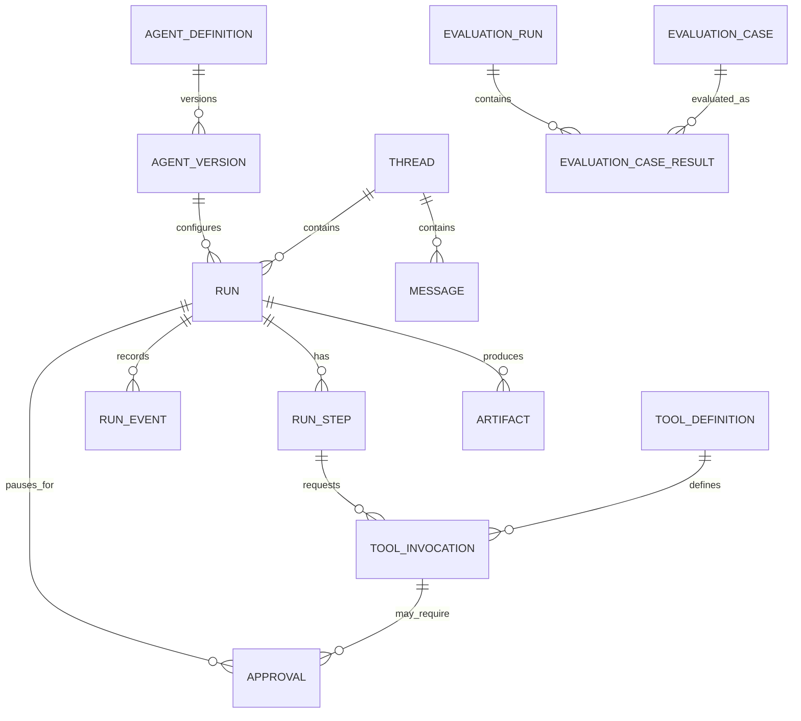

# Data Model and Persistence Specification

**Status:** PostgreSQL is the proposed application system of record. Entity names and schema details are conceptual until Phase 7.

## 1. Storage principles

- Store application truth in PostgreSQL; do not use Temporal history or telemetry traces as a substitute for application records.
- Separate conversation/thread identity from execution/run identity.
- Bind runs to immutable agent configuration versions.
- Keep run events append-oriented for audit and reconstruction, while allowing transactional state projections for efficient queries.
- Do not call the design “event sourcing” unless all authoritative state is actually rebuilt from events and the required replay/migration semantics are implemented.
- Use JSONB for bounded provider/tool payloads where schema evolution benefits from it, but retain important searchable/relational fields as typed columns.
- External side effects cannot be committed atomically with a local database transaction. Model uncertain outcomes explicitly.

## 2. Initial entities

| Entity/table (provisional) | Purpose | Important relationships |
|---|---|---|
| `agent_definitions` | Stable logical agent identity | Has versions |
| `agent_versions` | Immutable instructions/configuration/tool grants/model policy | Belongs to definition; referenced by runs |
| `model_profiles` | Logical role and routing policy | May reference model deployments |
| `threads` | Conversation or interaction container | Has messages and runs |
| `messages` | User/assistant/tool messages and content blocks | Belongs to thread; optionally run/step |
| `runs` | One execution attempt | Belongs to thread and agent version; has steps/events |
| `run_steps` | Model, tool, planning, approval, or workflow step | Belongs to run; parent/dependency references as needed |
| `run_events` | Append-oriented run lifecycle/audit events | Belongs to run; monotonically sequenced per run |
| `tool_definitions` | Versioned registered tool metadata | Referenced by invocations |
| `tool_invocations` | Tool operation intent, attempt, result, and outcome state | Belongs to run/step and tool version |
| `approvals` | Approval request/decision tied to exact action | Belongs to run and invocation/step |
| `artifacts` | Metadata for files/results produced by runs | Belongs to run; bytes may be stored on disk/object storage |
| `evaluation_cases` | Versioned evaluation inputs and expected criteria | Independent test corpus |
| `evaluation_runs` | Evaluation execution metadata | Has case results |
| `evaluation_case_results` | Per-case output, score, grader, and evidence | Belongs to evaluation run/case |

Add `tenant` or organization entities only when a real multi-user isolation requirement exists. The local-first design should still scope records to a local principal/workspace as needed, but avoid speculative multitenancy.

## 3. Conceptual relationships

## 4. Run/event semantics

`runs` stores the current queryable run state and stable fields (IDs, state, timestamps, agent version, thread, budgets, terminal result reference). `run_events` records meaningful state transitions and execution facts such as run accepted, model invocation requested/completed, tool approved/denied/started/completed, approval requested/decided, cancellation requested, and terminal outcome.

A per-run sequence or equivalent ordering mechanism should establish an unambiguous order for events. Design idempotent event insertion so retries do not create duplicate logical events. Event payloads should be versioned and bounded; large outputs/files should be artifact references, not embedded event blobs.

## 5. Idempotency and transactions

- Client `Idempotency-Key` applies to run creation and is scoped to caller/endpoint semantics.
- Tool invocation idempotency is distinct from run creation idempotency.
- Use unique constraints and transaction boundaries for claims/records.
- Persist external operation intent before execution when required; reconcile the result afterward.
- A worker crash between remote success and local result persistence creates an ambiguous outcome. Use provider-supported idempotency keys or read-after-write status reconciliation; otherwise record “unknown” and require a defined recovery/manual policy.
- Never claim exactly-once side effects across arbitrary systems.

## 6. Async database access

If SQLAlchemy async is selected, an `AsyncSession` is stateful and should not be shared across concurrent tasks. Use session/transaction scopes appropriate to a single asyncio task/unit of work. Do not pass a live session through a long-running agent context or hold transactions open while waiting for model/network calls.

## 7. Artifacts

Store artifact metadata (owner/run, path or object key, media type, size, checksum, retention, classification, creation time) in PostgreSQL. Store bytes on local disk or a later object-store-compatible backend. Resolve paths through an artifact service; never let model/tool output choose arbitrary host paths. Apply quotas, path normalization, cleanup, and access controls.

## 8. Retention and privacy

Define retention separately for messages, raw model/tool payloads, audit events, traces, and artifacts. Provide redaction/deletion behavior that preserves required audit semantics without retaining sensitive content unnecessarily. Do not retain full raw prompts/tool outputs by default if metadata/digests suffice for debugging.

## 9. Database evaluation

See `research/POSTGRES_18_VS_19.md`. Version/driver decision must consider compatibility, migrations/extensions, backup/restore tooling, concurrency correctness, query plans, index behavior, autovacuum, and representative workload performance—not only feature novelty.
