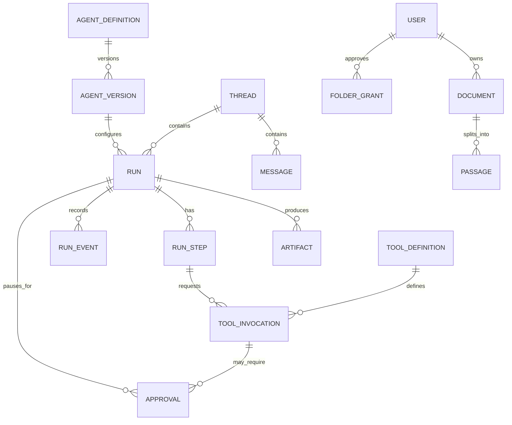

# Data Model

**Status:** PostgreSQL is accepted as the system of record. Tables and columns are conceptual until Phase 7. The major version and driver are open ([research note](research/POSTGRES_18_VS_19.md)).

## Principles

- PostgreSQL holds application truth. Temporal history and telemetry are not substitutes.
- A thread (conversation) and a run (one execution) are separate entities.
- Each run references an immutable agent configuration version.
- Run events are append-only, for audit and replay; current-state tables exist for fast queries. This is not event sourcing, and the docs shouldn't call it that.
- JSONB for bounded provider and tool payloads; typed columns for anything that is queried or constrained.
- A local transaction cannot include a remote side effect. Uncertain outcomes are modelled explicitly.
- Transactions stay short and never span a model or network call.

## Entities

| Table | Purpose |
|---|---|
| `agent_definitions` | Stable logical agent identity |
| `agent_versions` | Immutable instructions, tool grants, model policy |
| `model_profiles` | Role and routing policy |
| `threads` | Conversation container |
| `messages` | User, assistant, and tool messages with content blocks |
| `runs` | One execution: current state, budgets, result reference |
| `run_steps` | A model, tool, planning, or approval step |
| `run_events` | Append-only lifecycle facts, sequenced per run |
| `tool_definitions` | Versioned tool registrations |
| `tool_invocations` | Intent, attempt, result, and outcome state |
| `approvals` | A request and decision tied to one exact action |
| `artifacts` | Metadata for files produced by runs (bytes stored elsewhere) |
| `users`, `folder_grants` | Accounts and per-user approved folders (milestone 3; a single local principal before that) |
| `documents` | Indexed file: owner, path, size, modification time, content hash, version where known, `language` (detected, BCP 47), `classification` (`public`, `internal`, `restricted`) |
| `passages` | Searchable chunk of a document with section and line range, and a full-text index |

Every record that belongs to someone carries the owning principal from the start, so adding accounts in milestone 3 needs no migration of meaning. No organisation or tenant tables beyond that.

Evaluation cases and results stay as versioned files in `evals/`, not database tables, until there is a reason to query them.

## Runs and events

`runs` holds the current state and the stable fields. `run_events` records facts: accepted, model requested and completed, tool approved, denied, started, and completed, approval requested and decided, cancellation requested, terminal outcome.

Events have a per-run sequence number and idempotent insertion, so a retry cannot duplicate a logical event. Payloads are versioned and bounded; large outputs are stored as artifact references.

## Idempotency

- A client `Idempotency-Key` applies to run creation, scoped to caller and endpoint.
- Tool invocation idempotency is a separate mechanism.
- Claims and records are protected by unique constraints and transactions.
- Persist intent before an external operation; reconcile afterwards.
- A crash between remote success and the local write leaves an ambiguous outcome. Resolve it with the remote side's idempotency key or a status check; otherwise record `unknown` and apply a defined recovery policy.
- No claim of exactly-once effects across arbitrary systems.

## Async access

SQLAlchemy's `AsyncSession` is stateful and must not be shared between concurrent tasks. Use one session per unit of work. Never pass a live session through long-running agent context or hold a transaction open while waiting on a model or the network.

## Artifacts

PostgreSQL stores the metadata: owner, run, path or object key, media type, size, checksum, retention, classification. The bytes go on local disk, or an object store later. Paths resolve through an artifact service; model or tool output never chooses a host path. Quotas, path normalisation, cleanup, and access control all apply.

## Retention

Retention is defined separately for messages, raw model and tool payloads, audit events, traces, and artifacts. Deletion and redaction keep required audit facts without keeping sensitive content. Raw prompts and tool output are not stored by default when metadata or digests are enough.
